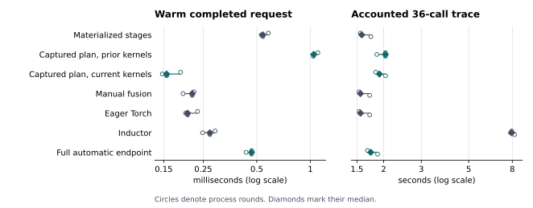

# When does a folded relocation help? Issue 274, artifact v1

This evaluation follows a relocation from its compiler-produced plan through a completed application request. The comparison changes at each boundary. A plan can save a materialization even when a manual kernel runs faster. Reusing a plan can reduce preparation even when the framework endpoint takes longer. The original model and capacity experiments put those effects in context.

## Completed application requests

The prospective experiment measures a pretrained SqueezeNet 1.1 on real image crops from normalized CPU pixels to completed GPU logits. The protocol, admission rule, controls, assets, stopping rule and paired p95 test were published before timing. Each arm gets the same 112 inputs and resident FP32 model. Each compiled arm gets a fresh compiler cache and the same Inductor options. The model runs on one RTX 4070 Ti SUPER. [Protocol freeze](https://github.com/JueonPark/sym/commit/9a986f34a1ef9e14d693e5236a49a7567e1cd130) · [Application protocol](APPLICATION_PROTOCOL.md) · [Raw processes and logs](application-records.tar.gz)

| Completed time, median across six fresh processes | Torch eager | Torch Inductor | Sym + Inductor |
| --- | ---: | ---: | ---: |
| Warm p50 (ms) | 2.989 | 2.207 | 1.804 |
| Warm p95 (ms) | 5.523 | 5.022 | 4.154 |
| Cold first request (s) | 0.233 | 11.711 | 5.506 |
| Accounted 112-call lifecycle (s) | 1.907 | 14.238 | 7.893 |

The automatic path reduced warm p95 in all six pairs against Inductor. Its paired geometric mean latency ratio was **0.795** (95% process-pair bootstrap interval **0.634–0.904**), meeting the prespecified criterion. Warm p50 regressed in one pair. Eager had the lowest accounted 112-call cost. The latency result covers the entire compiled inference function, including the effects of the rewrite on its consumer. Isolating the native layout kernel's contribution would require a separate intervention. [All round ratios, phases and memory observations](APPLICATION_RESULTS.md)

In each Sym process, the default policy used Torch on the first call, built one native group, and executed the next 111 requests with 110 rebinds. All 2,016 measured and warmup logits passed the eager-reference tolerance and top-1 check. After timing, three transferred tensors matched the eager bits and survived owner retirement. The strided view took the guarded fallback. These observations qualify a reusable FP32 input transformation with changing values and sufficient repeated work. [Runner and checks](application.py) · [Versioned receipts](application-records.tar.gz)

## Where a measured benefit survives

| Question | Observation | Reproducible comparison |
| --- | --- | --- |
| What does folding itself save? | True folded execution beat stage-by-stage materialization in 35/36 original E1 settings. Manual fusion beat the folded path in 31/36. The matched arms preserve intermediate rounding and complete the transfer. | [Fixed E1–E5 replay](BASELINE_RESULTS.md) |
| Do better kernels explain the whole result? | #267 changes native kernels on identical plan bytes. Its explicit recipes beat the fastest manual/Torch comparator in 28/36 cells. For one #272 *captured* plan, current kernels beat eager on warm execution, and eager won over the accounted 36-call trace. | [Kernel controls](../issue267/RESULTS.md) · [Captured plan](../issue272/CAPTURED_QUALITY.md) |
| Does preparation pay under changing inputs? | #272 saved 8.74% on repeated layout-cast requests with specialization caching. Changing the eligible parameter revision every time produced zero hits. #265's selected automatic policy took 1.52–7.04× matched Torch time across the original E3 cells. The held-out witness checks both safe rebinding and fallback. | [E3 shape-trace validation](BASELINE_RESULTS.md) · [Admission and dispatch](../issue265/RESULTS.md) · [Independent reuse toggles](../issue272/RESULTS.md) · [Held-out guards](../issue272/WITNESS.md) |
| Do the savings reach matched model requests? | Original FP16 E2 lost to matched Torch in all eight cells. Its retrospective paired p95 slowdown was 4.8–11.0%. #263 traced the cost of materializing submission reports. #264 improved on the frozen runtime by 2.24–10.28% and beat matched Torch in four of eight cells. The matched controls share native kernels, grouping, prefetch and eligible compiled consumers. | [Original pairs](BASELINE_RESULTS.md) · [Profiled diagnostics and unprofiled acceptance](../issue263/RESULTS.md) · [Group reuse with fixed reporting](../issue264/RESULTS.md) |
| Which memory savings buy capacity? | Under a physical 512 MiB free budget both full-offload paths served 768 MiB of weights. In one partial cell, Torch fit 3/3 while Sym failed 3/3. #266 recovered that cell. In four-caller decode, adaptive buffering reduced a sampled warm peak from 956 to 526 MiB while sojourn p95 increased from 157.82 to 243.97 ms. | [Original E4 including all OOMs](BASELINE_RESULTS.md) · [Packing, residency, preload and scratch controls](../issue266/RESULTS.md) |
| Which replay and consumer controls qualify? | #268 replay beat its own stable-slot wrapper with capture disabled in all 45 successful Sym round comparisons. Only 1/16 cell medians beat plain Sym. #269's KV rewrite removed eager intermediates, matched Inductor's observed kernel count and qualified 0/24 paired model comparisons at 5%. The separate tight-budget native path recorded six OOMs. | [Replay and wrapper OOMs](../issue268/RESULTS.md) · [Matched consumer opportunities](../issue269/RESULTS.md) |
| What does forwarding a private intermediate remove? | With the same plan, binding and row, #270 eliminates a private host clone and transfer-result temporary. The output allocation and wire traffic remain chargeable. The v1 replay publishes the per-binding logical byte counts and executed rows. | [Legality and exclusions](../../docs/relocation-regions.md) · [Fresh untimed replay](region-replay/README.md) |
| What can the joint planner predict? | #271 exhausts 585 plan/budget combinations. All 358 admitted candidates passed the bit and arena-peak checks. The arena refused 227. Median warm regret against the feasible oracle was 13.23% for joint search, 24.81% for placement alone and 103.28% for per-transfer selection. Joint search missed 3/4 feasible paced deadlines. | [Training and held-out calibration, 899 ms calibration cost, objective-specific controls and oracle](../issue271/RESULTS.md) |



Each open circle is one #272 process, the diamond its cross-process median. Both panels use a logarithmic time axis. One 620-byte captured plan on current kernels completed in 0.156 ms warm, compared with 0.217 ms manual and 0.204 ms eager. The automatic endpoint took 0.467 ms. Including acquisition in the 36-call comparison, the captured-plan arm took 1,911.781 ms and eager took 1,557.809 ms. Each process used one cold request, five warmups and 30 scored warm requests per arm. These measurements describe the held-out cast/permutation. [Process records and accounting](../issue272/CAPTURED_QUALITY.md) · [Figure source](plot_capture.py)

## Scope of the evidence

- **Memory and lifecycle.** The historical reanalysis retains the 120 primary E4 attempts and six packed-resident controls. Failed attempts contribute to the failure denominator and successful attempts to the latency distribution. E5 charges cold use, warm windows, shape/scale revisions and owner retirement. Device-wide used-memory differences are observed lower bounds over the sampling interval. Physical device observations, allocator reservations, host RSS, pinned host memory and native ownership counters have different scopes. [Historical results](BASELINE_RESULTS.md) · [Revision and measurement catalog](CATALOG.md)
- **Concurrency.** In E5, total lifecycle cost lost all 12 paired rounds and fixed-burst throughput lost all 18. Sojourn p95 includes queue wait. The 36 burst processes and the planner's finite 40-arrival study use different workloads and load models. Sustained-service throughput at a p95 SLO needs offered-load sweeps, bounded queues, fill/drain and backpressure from the separate scheduler study. [Fixed-burst replay](BASELINE_RESULTS.md) · [Paced planner results](../issue271/RESULTS.md) · [Open scheduler study #253](https://github.com/JueonPark/sym/issues/253)
- **Generality.** The historical campaigns cover different operations on a Turing RTX 2080 Ti and an Ada RTX 4070 Ti SUPER. The pretrained application was run on Ada only, in FP32, batch one, with one image and fixed tensor shape. The evidence supports conclusions about these workloads and measured devices. BF16 model performance, cross-device scaling of this application, dataset accuracy and developer effort require separate measurements. [Hardware and workload catalog](CATALOG.md) · [Pinned application inputs](application-assets.json)

## Reproduce the results

From the root of a checkout containing this release, verify the new files and the historical repository inputs. To replay the application receipts, use Python 3.10+ and an empty extraction directory. This scoring path requires no GPU, pretrained weights or Torch install.

```sh
(cd bench/issue274 && sha256sum -c SHA256SUMS)
python -m bench.issue274.verify_catalog
mkdir -p /tmp/sym274-replay
tar -xzf bench/issue274/application-records.tar.gz -C /tmp/sym274-replay
python -m bench.issue274.verify_application /tmp/sym274-replay/application-records/accepted
```

The [historical catalog](CATALOG.md) identifies the immutable Wiki source, checksum of each downloadable part, aggregate archive checksum, contents and environment for each campaign. The [baseline replay](BASELINE_RESULTS.md) gives the CPU-only command to regenerate the E1–E5 results from the original snapshot at Sym revision `2617ba1`. For the figure, install Matplotlib 3.10.8 and run `python -m bench.issue274.plot_capture` from the repository root. The [SqueezeNet report](APPLICATION_RESULTS.md) gives the commands to reproduce the application campaign on CUDA and recover the per-round estimates. The [study protocol](PROTOCOL.md) records the distinction between retrospective reanalysis and the prospective application test.
